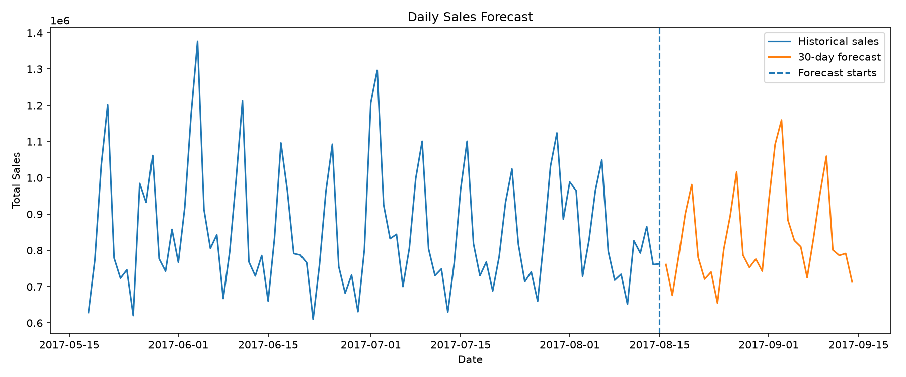
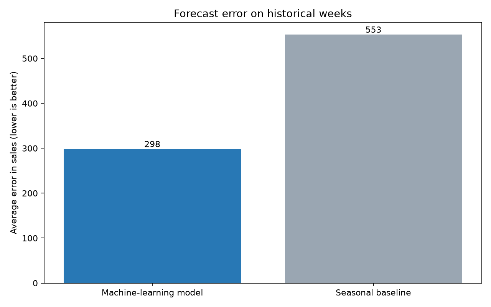

# Sales and Demand Forecasting

## Project Overview

This project explores retail sales forecasting in two stages:

1. An initial model forecasts total daily sales across all stores and product families.
2. A rebuild forecasts weekly sales separately for each store and product family, then compares a shared machine-learning model with a simple baseline.

The forecasts demonstrate how historical sales patterns can support business planning. They are not current forecasts or automatic stock-order recommendations.

## Dataset

The project uses the [Store Sales — Time Series Forecasting dataset from Kaggle](https://www.kaggle.com/competitions/store-sales-time-series-forecasting/data).

The `train.csv` file contains 3,000,888 daily records from 1 January 2013 to 15 August 2017. The data includes dates, stores, product families, sales, and promotions.

The dataset is not included in this repository. Download `train.csv` from Kaggle and place it in the project folder before running either workflow.

## Technologies

- Python
- Pandas
- NumPy
- Scikit-learn
- Matplotlib

## Workflow 1: Daily Aggregate Forecast

The original `main.py` workflow:

1. Prepares the data and totals sales across all stores and product families for each date.
2. Creates calendar, lag, and rolling-average features.
3. Trains a Random Forest regression model.
4. Compares it with a seasonal-naive baseline using a 30-day historical validation period.
5. Forecasts 30 days beyond the final date in the dataset.

### Original model evaluation

| Metric | Random Forest | Seasonal-naive baseline |
|---|---:|---:|
| MAE | 56,821.24 | 60,671.64 |
| RMSE | 78,797.51 | 91,695.52 |
| WAPE | 6.82% | 7.28% |

The Random Forest had lower errors than the baseline on this validation period. Its MAE was about 6.35% lower.

The original forecast covers **16 August to 14 September 2017**. It is based on historical data and is not a forecast for the present day.



## Workflow 2: Weekly Store and Product-family Forecast

The rebuild uses `forecast_by_store_family.py` to prepare weekly sales for each store and product family. It creates 431,244 weekly records, including partial weeks. The forecasting workflow uses the 427,680 complete-week records.

The `forecast_and_evaluate.py` script:

1. Creates calendar features and features based on earlier sales, including lagged sales and rolling averages.
2. Trains one shared `HistGradientBoostingRegressor` model across the store-family records.
3. Evaluates the model on three historical periods, each four weeks long.
4. Compares it with a baseline that uses sales from about the same week a year earlier, or a recent average when that value is unavailable.
5. Produces a 12-week forecast for each store and product family.

### Rebuild evaluation

The model and baseline were compared on **21,384 weekly records**.

| Metric | Shared machine-learning model | Seasonal baseline |
|---|---:|---:|
| MAE | 297.99 | 552.66 |
| WAPE | 8.78% | 16.29% |

The model’s MAE was **46.08% lower** than the baseline’s across these historical checks. This describes the tested periods; it does not guarantee the same performance on future or current data.

The 12-week forecast starts after the last complete week in the dataset, **7 August 2017**. The forecast covers weeks beginning 14 August to 30 October 2017. It is historical and not a current business forecast.



## What the Forecast Means for a Business

A forecast is an estimate of future sales based on patterns in past sales. Each row in `sales_forecast_v2.csv` estimates weekly sales for one store and one product family.

A store manager could review these estimates to help prepare for busier or quieter weeks, plan staffing, or decide which product families may need closer attention. The forecast is not guaranteed, and a manager should consider other information before making business decisions.

The weekly rebuild chart compares historical forecast errors; it does not plot the new 12-week forecast. The original daily forecast chart above shows its 30-day prediction.

## Running the Project

### Requirements

Install Python. The required libraries are listed in `requirements.txt`.

Download `train.csv` from Kaggle and place it in the project folder.

In PowerShell, open the project folder and create a virtual environment:

```powershell
python -m venv .venv
```

Install the libraries:

```powershell
.\.venv\Scripts\python.exe -m pip install -r requirements.txt
```

### Run the original daily workflow

```powershell
.\.venv\Scripts\python.exe main.py
```

### Run the weekly store-family rebuild

First prepare the weekly data:

```powershell
.\.venv\Scripts\python.exe forecast_by_store_family.py
```

Then evaluate the model and create the 12-week forecast:

```powershell
.\.venv\Scripts\python.exe forecast_and_evaluate.py
```

The scripts create `outputs/` and `outputs_v2/` folders on your computer. The result files displayed in this GitHub repository are uploaded at the top level. The generated `weekly_sales.csv` is an intermediate file and is not required in the repository.

## Results and Output Files

The original workflow creates:

- `historical_sales.png` — historical total daily sales.
- `validation_comparison.png` — actual and predicted sales during validation.
- `future_forecast.png` — historical sales and the 30-day forecast.
- `validation_results.csv` — actual and predicted values for validation.
- `model_comparison.csv` — original model and baseline metrics.
- `sales_forecast.csv` — daily sales estimates for the forecast period.

The weekly rebuild creates:

- `data_summary.txt` — summary of the prepared data.
- `forecast_evaluation_v2.png` — comparison of historical model and baseline errors.
- `forecast_summary_v2.txt` — plain-English summary of the results.
- `model_comparison_v2.csv` — model and baseline metrics.
- `sales_forecast_v2.csv` — 12-week estimates by store and product family.

## Limitations

- The dataset ends in August 2017, so its forecasts demonstrate the method and do not describe current business conditions.
- The weekly rebuild predicts sales by store and product family. Sales may not show all customer demand if a product was unavailable.
- The dataset does not include current stock levels or supplier delivery times. The forecasts cannot calculate exact reorder quantities.
- The weekly rebuild does not use all potentially useful information, such as promotions, holidays, or store details, as model features.
- Forecasts support planning and should be reviewed by people familiar with the business.

## Project Information

- **Program:** Future Interns Machine Learning Internship
- **Track:** Machine Learning
- **Task:** Task 1 — Sales and Demand Forecasting
- **Repository:** `FUTURE_ML_01`
